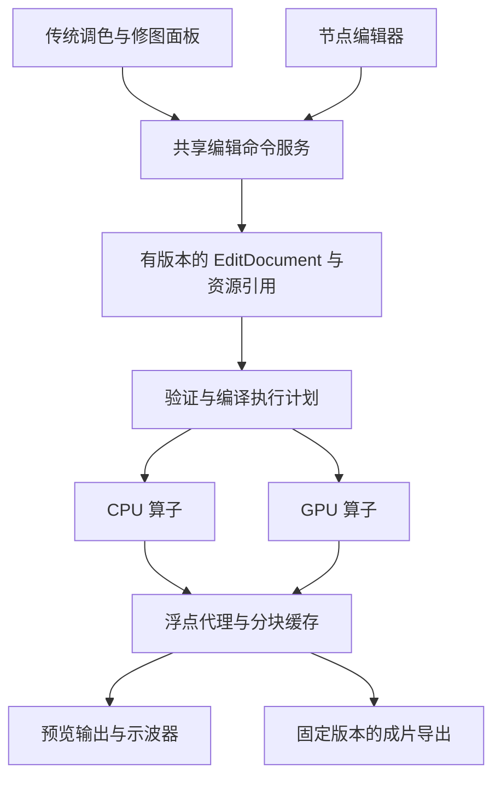

# 调色与修图后端设计：统一编辑图与高精度渲染

更新：2026-10-14。状态：**传统调色后端已实现并通过分支 CI，传统面板尚未接入**。本文保留完整产品设计目标；逐项代码状态和限制见[传统调色后端实现](color-engine-implementation.md)，提交对应证据见[CI 记录](ci-verification.md)。当前调色、修图页面仍是工作区占位，不能把后端验收计作可用的完整产品。

目标是先建立本地照片显影和非破坏编辑能力，再分别接入传统面板与节点编辑器。Lightroom、像素蛋糕用于界定摄影工作流目标，DaVinci Resolve 用于界定节点交互目标；本文不推断这些商业软件未公开的内部实现。

依据：当前代码、用户提供的两份研究原文及已合并的《后续调色软件技术储备》、文末开源项目的一手资料。原始研究资料保存在本地忽略目录，不作为公开源码依赖。本文中的目标与候选方案不自动代表已实现；以实现清单和验证证据为准。

## 1. 核心决策

1. **一份编辑文档、一张有类型的有向无环图、两种前端视图。** 传统面板操作预设节点组；节点编辑器操作同一张图。不维护两套可相互漂移的调色参数。
2. **从解码入口保留高精度，核心计算采用 FP32。** 当前 8-bit 选片预览保留其用途，正式显影重新读取原片；将 JPEG 预览转换为浮点无法找回已经丢失的信息。
3. **交互速度由缓存、局部计算、GPU 和调度共同保证。** 拖动时降低空间分辨率，避免每次重新解码原片；不把中间结果压成 8-bit 来换速度。
4. **先做完整的小闭环。** 高精度输入 → 曝光/基础颜色 → 同一编辑图的预览和导出 → 保存恢复；尽早验证 GPU 与桌面显示传输，再扩充算子。
5. **先完整传统调色，再辅助选区，最后自动决策。** 第一产品阶段必须在没有模型和网络时完成日常全局与局部调色；之后先加入语义蒙版，再加入自动调色、参考图追色。参数预测、蒙版生成、像素修复作为可替换节点接入。

### 1.1 功能边界与首阶段完成定义

根据用户 2026-10-13 的进一步要求，“传统调色该有的都有”落实为下面的功能清单。不是复制某个商业产品所有历史功能，也不是只做几个滑块后马上转向 AI。以下是完成标准，采用传统算法，基础工作流不依赖下载模型；当前实现逐项记录在单独的实现清单。

| 类别           | 首阶段应具备的能力                                                     | 范围说明                                                       |
| :------------- | :--------------------------------------------------------------------- | :------------------------------------------------------------- |
| 显影与颜色基础 | 高精度 RAW/普通图输入、相机输入配置、白平衡/吸管、色彩管理             | RAW 与已渲染图像的输入能力分别声明；不冒充其他软件专有相机风格 |
| 基础影调       | 曝光、对比度、高光、阴影、白场、黑场                                   | 每个控制有明确算法与顺序；不是给曝光乘法套六个名称             |
| 曲线           | RGB 总曲线、各通道曲线、参数化影调曲线                                 | 可重置、可编辑控制点，明确工作域和超范围行为                   |
| 颜色           | 色温/色调、饱和度/自然饱和度、HSL 混色、阴影/中间调/高光色轮、黑白混色 | 保留局部颜色控制；局部色温不是传感器白平衡的重复应用           |
| 质感与细节     | 纹理、清晰度/局部对比、去雾、锐化、亮度/颜色降噪                       | 区分作用尺度和参数；传统降噪先可用，不等 AI 降噪               |
| 光学与几何     | 裁切、旋转/拉直、透视、畸变/暗角/色差校正                              | 镜头配置适配与手动控制；未知镜头不能伪装成已有自动配置         |
| 传统蒙版       | 画笔/擦除、线性/径向渐变、亮度范围、颜色范围                           | 支持多蒙版、命名、显隐、反选、羽化、强度及加/减/交集           |
| 局部调整       | 在蒙版内调影调、曲线、颜色与支持的细节参数；局部提亮/压暗              | 可用项由算子能力决定；传感器校准等源阶段操作不硬套局部蒙版     |
| 风格工具       | 预设、声明色彩域的 LUT、颗粒、创意暗角                                 | 可调整强度、可保存组合；与光学暗角校正分开                     |
| 编辑工作流     | 前后对比、单项/整体重置、撤销重做、历史、虚拟副本、复制粘贴、批量同步  | 参数与源关联资源区分；每张图独立历史；批量操作可恢复           |
| 查看与输出     | 缩放/平移、原尺寸细节、直方图和剪切提示、软打样、颜色/位深可选导出     | 显示与成片共享颜色合同；16-bit TIFF、JPEG 和批量输出闭环       |

传统修图中的仿制、修复画笔、局部光影修饰也不必依赖 AI；它们属于相邻的“修图”工作区，后续以传统修图批次接入同一编辑图。完整图层绘画、排版、全景/HDR 合成、复杂液化不作为传统调色完成的前置条件，避免无限扩大范围。

首阶段完成指上述调色清单有实际后端能力、传统面板入口、可保存状态与正确输出，而不只是节点类型或 API 已存在。每项分别跟踪实现状态；性能建设贯穿整个阶段。节点编辑器共用这些能力，可独立安排前端开发，不改变“先传统调色、后 AI”的功能顺序。

## 2. 当前代码能复用什么

| 现有边界                                                | 已确认行为                                                                           | 后续处理                                                                   |
| :------------------------------------------------------ | :----------------------------------------------------------------------------------- | :------------------------------------------------------------------------- |
| [预览解码](../crates/iris-core/src/vision/decode.rs)    | `DecodedPreview.image` 是 `RgbImage`；普通图像进入 `to_rgba8()`，透明像素合成到白底  | 保留选片路径；新增高精度显影接口，保留输入位深、ICC 和 alpha               |
| [RAW 子进程](../components/raw-decoder/src/main.rs)     | `RawDevelop` 结果进入 `to_rgb8()`，输出 PPM P6、最大值 255；完整显影限制 24MP        | 复用进程隔离，新增有版本的浮点数据协议；先核实中间数据是否已施加曲线或截断 |
| [RAW 区域显影](../components/raw-decoder/src/region.rs) | 具有区域处理，但传感器解压仍需完整帧，不能等同于任意 RAW 的局部解码                  | ROI 能减少后续计算；不能据此取消原始帧内存预算                             |
| [媒体缓存](../crates/iris-core/src/services/media.rs)   | 以照片、修改时间、大小、边长等生成 JPEG 缓存；文件工作移出数据库锁，发布前复查源文件 | 复用短锁与原子发布原则；调色缓存另加编辑、色彩、资源和算子版本             |
| [媒体队列](../crates/iris-daemon/src/media_queue.rs)    | 有界排队、取消、前台优先和解码并发上限                                               | 保留快速选片服务；新增预算协调，避免显影、AI 和导出争抢内存/显存           |
| [现有导出](../crates/iris-core/src/services/exports.rs) | 原文件复制、选择结果与 XMP 等；不是调色后的像素导出                                  | 新增 rendered export，原有复制导出语义不变                                 |

项目、照片 ID、任务状态、资源管理和选片分组可以复用。当前预览直方图不能作为高精度显影的数值依据；新示波器需要指明采样阶段、色彩域、单位和编辑版本。

## 3. 位深与色彩管线

### 3.1 精度合同

这里的位深均指**每通道**，不是整张图或一个 RGB 像素的总位数。

| 层级                   | 建议格式                                    | 约束                                                                                        |
| :--------------------- | :------------------------------------------ | :------------------------------------------------------------------------------------------ |
| RAW/高位深图像输入     | 保留原始有效精度与元数据                    | 解码至浮点前不能经过 8-bit RGB/JPEG；读取原片，不使用内嵌预览代替最终输入                   |
| CPU 核心运算和数值参考 | 32-bit 浮点 RGB/RGBA                        | 明确颜色含义；允许负值和大于 1 的有限值，不在每个节点强行裁切                               |
| GPU 核心运算           | FP32 起步                                   | 不承诺与 CPU 逐位相同；按算子验证误差                                                       |
| GPU 中间缓存           | FP32 起步，按算子评估 FP16                  | FP16 与 16-bit 整数不是同一种精度；经动态范围和累积误差验证才开放优化                       |
| 低分辨率线性代理       | 浮点、降低宽高                              | 拖动滑块复用；不能退化成旧 JPEG 缓存再作为调色输入                                          |
| 普通屏幕预览           | 输出变换后的 sRGB 图像，初期可用 8-bit 传输 | 这是显示终点；编辑和导出继续使用浮点源。10-bit/HDR 显示需要单独验证操作系统、窗口和显示设备 |
| 第一阶段成片导出       | 8-bit JPEG、16-bit 整数 TIFF，嵌入目标 ICC  | 编码前才量化，必要时抖动；以后可加浮点 EXR 中间文件                                         |

8-bit 每通道只有 256 个整数码值；16-bit 整数有 65,536 个。FP32 主要提供运算精度与动态范围，不能用相同方式理解成均匀的整数色阶。源文件本来是 8-bit 时，浮点运算能减少后续累计误差，但不会增加原始拍摄信息。

### 3.2 输入与工作域

建议第一版使用**场景线性 Rec.2020、D65 白点**作为 RAW 显影后的默认工作域，作为待数值样例验证的设计选择。它不是“唯一专业标准”；工作域写入文档和节点合同，以便以后显式接入 ACEScg 等空间。vkdt 的显示模块接受线性 Rec.2020，是相关实践参考。[S2]

RAW 输入的基本职责是黑白电平与坏点处理、相机白平衡、去马赛克、相机颜色配置与工作域转换。具体先后依赖算法；第一版由受管理的输入子图明确固定。不得将后端默认显影中的色调曲线误当作线性数据，也不能重复施加白平衡或色适应。

相机原始白平衡通常应在传感器/相机色彩阶段处理。传统面板中的 RAW 色温滑块因此可以修改输入子图；它并非永远是工作域后面的一个通用 RGB 乘法。

JPEG、普通 TIFF/PNG 等可能已经完成相机风格、色调映射和裁切。按嵌入 ICC/传递函数解码，并记录 `reference_kind = scene | display`；把编码值线性化不会恢复场景辐射或被裁切的高光。默认已渲染图像不再自动叠加 RAW 的场景色调映射。缺少配置时的 sRGB 假设必须记录；损坏配置和不支持配置应返回明确状态。

色彩管理分为相机输入、创意运算、输出映射、显示配置。所有节点声明 gamut、白点、transfer 和 reference kind。输出映射负责目标动态范围与色域，随后进行 ICC/编码处理，避免双重 gamma、双重色调映射。

ICC 候选使用 LittleCMS；OCIO 作为后续可选的 look/输出变换适配器。[S6][S7] 不同时强制接入 ACES、AgX、CAT16。OCIO 的 GPU shader/纹理资源也不意味着可以直接变成 wgpu 的 WGSL，需单独原型验证。

### 3.3 显示、透明度与 LUT

- 第一阶段以带清晰 sRGB 含义的预览交给浏览器/WebView 显示；确认宿主的色彩管理行为。不能先按显示器 ICC 转换，再让浏览器重复转换。
- 以后若需受控的广色域/HDR 输出，可增加原生显示 surface；不能由“GPU 支持浮点”推导出整个 WebView 已支持正确的 HDR 显示。
- 点运算使用明确的直通 alpha 约定；重采样、滤波和合成在需要时显式预乘/去预乘，并处理 alpha 为零。蒙版值不参加颜色转换。
- LUT 必须声明输入输出色彩域、数值范围、shaper、插值和越界策略。未声明的导入 LUT 需要选择解释方式，不能任意套在线性 RAW 上。
- 曝光基础算子使用 `out = in * 2^EV`，但色调映射、高光重建与感知亮度是独立问题；公式本身不保证所有后续效果保色相。

## 4. 同一后端支持两种前端

必须分开三种数据：**持久化编辑图**表达用户意图；**执行计划**描述任务、算子融合和内存复用；**界面布局**保存节点坐标、面板折叠状态。移动节点位置不应使像素缓存失效。

默认文档提供 `BaseDevelop` 受管理节点组，包含稳定节点 ID、语义角色和可公开参数。传统曝光、白平衡、曲线、颜色、裁切面板都绑定这些节点；节点界面可显示组或展开内容。

例如，传统面板把曝光改成 +1EV，就是更新同一 `Exposure` 节点；切到节点视图后参数仍是 +1EV。两种视图提交相同文档版本，渲染器没有“传统算法”和“节点算法”的区别。

自由节点图不一定能归纳为一个全局曝光值。用户添加支路或移除受管理节点后，后端返回 `managed / custom / unavailable` 等面板能力：仍可操作存在的标准组，或显示所选节点的参数。重建默认组必须是可撤销的明确操作；切换界面不能丢弃、拍平或偷偷重排自定义节点。

顶层“导入、选片、调色、修图、导出”表示工作区，不强迫每张照片依次完成全部阶段。调色与修图修改同一编辑文档；导出固定其中一个版本。

### 4.1 节点合同

每种节点注册以下信息：类型 ID、算法版本、参数 schema、输入输出端口、色彩域、CPU/GPU 能力、边界/ROI 规则、成本估计和可取消粒度。参数和连线修改作为一次事务验证。

| 类型       | 例子                       | 执行要求                                           |
| :--------- | :------------------------- | :------------------------------------------------- |
| 点运算     | 曝光、矩阵、部分曲线/LUT   | 可按白名单融合，减少显存读写                       |
| 邻域运算   | 锐化、局部对比、羽化       | 声明采样半径和 halo，统一图像边缘策略              |
| 几何运算   | 裁切、旋转、镜头校正、液化 | 反向计算所需输入区域，传递坐标映射                 |
| 全局运算   | 自动曝光统计、全图直方图   | 先做版本绑定的归约，不允许各 tile 独立决定全局参数 |
| 外部生产者 | AI 蒙版、修复图像          | 输入指纹、模型/预处理版本、可缓存资源产物          |

端口至少区分 `Image<ColorDomain>`、`Mask<CoordinateAnchor>`、`Depth`、`Lut`。串行、蒙版混合、并行分支和图层混合由明确节点表达。拒绝循环、缺失资源、非法参数、域不匹配和超预算图；不能在不告知用户的情况下跳过未知节点继续导出。

加载未知版本节点时保留原文档，允许检查信息；在完成迁移或恢复依赖前阻止相关完整渲染。运行时不加载任意第三方代码，第一版只注册随应用发布的算子。

## 5. 文档、撤销与资源

`EditDocument` 建议包括 schema 版本、source ID/指纹、原始尺寸及方向、输入解释、工作域、节点与边、输出配置、资源引用和面板绑定。界面布局单独存储。一个源照片可以有多个虚拟版本，原文件共用。

继续使用现有数据库服务，新增编辑文档、修订、资源和成片导出任务等逻辑实体；不另起数据库服务器。CPU/GPU 渲染读取不可变快照，不持有数据库锁工作。

- 命令带 `expected_revision` 和 `request_id`，防止两个面板相互覆盖并支持重试幂等；冲突返回当前版本，不静默覆盖。
- 拖动开始创建临时预览会话，更新只保留最新序号；松手将一次手势提交为一条撤销记录。取消手势丢弃草稿；草稿恢复与已提交历史分开。
- 撤销/重做也生成新的单调递增修订号，引用历史状态；采用快照加差量和明确保留策略，不宣称无限历史。
- 蒙版、LUT、修复结果以内容哈希存储。历史、当前文档和运行中的导出会固定其引用，垃圾回收不得提前删除。
- 可增加显式导出的 `.iris-edit.json` 配方与资源清单；不默认在用户原片旁写文件。XMP 继续承担已有交换用途，不声称兼容 Adobe 的整套调色参数。

源文件变化时重新核对输入解释、尺寸和资源锚点；旧编辑保留并显示失配状态，不把新照片当作旧照片无感渲染。批量复制只复制可迁移的语义参数，不能盲目复制相机矩阵、人脸坐标或源文件引用。

## 6. 速度、并行化与大图

### 6.1 三档计算

1. **交互档**：已驻留的浮点代理、当前视口、最新参数；优先最短可见响应。
2. **稳定档**：停止拖动后补足当前缩放的精度，100% 时按可见区域与边界扩展计算。
3. **输出档**：绑定文档快照和源指纹，全分辨率分块求值、目标颜色转换与编码。

三档共用算子定义和版本。锐化半径、蒙版羽化和几何尺寸按完整图像坐标定义，不能随预览尺寸改变实际编辑意图。明确哪些预览只是近似，不能把低分辨率预览升级标记成原图完成。

### 6.2 缓存与失效

节点缓存键由上游内容、参数、算法版本、输入域、资源哈希、源指纹、ROI/尺度、质量档及执行实现/精度共同决定。显示目标变更只失效显示分支；改曝光不重新做无依赖的主体分割；改裁切后按坐标规则重新取样蒙版。

文件大小/修改时间可作快速变化提示；进入编辑和固定导出输入时建立内容指纹。对活动文件读取前后复查，不把同大小、同时间戳当作内容绝对不变的证明。缓存文件原子发布，失败的部分文件不进入可见索引。

源图浮点缓冲或代理尽量复用，局部修改只重算依赖子图。执行计划按生存期回收临时 tile；点运算可做有限融合。第一版不做通用 shader JIT，也不为每个节点保存整张全分辨率图。

### 6.3 统一预算，而不是无限增加线程

新增资源协调器，为 RAW 解码、CPU tile、GPU、AI 和导出分配内存/显存预算及并发令牌。继续复用现有队列机制，但避免 Rayon、解码器和 ONNX 各自铺满 CPU。

交互通常高于稳定预览，稳定预览高于预取和后台批量任务；后台配置最低进度配额/等待老化。取消在 tile 或 dispatch 边界生效，不承诺正在运行的整帧 GPU 任务可以瞬时抢占。

每个预览结果携带 source、revision、会话 generation、目标和质量标识。旧请求即使完成也不能覆盖新画面；导出固定快照后不追随用户继续拖动滑块。

60MP RGBA FP32 一帧约 960MB（约 916MiB），四帧约 3.84GB，尚未包含 RAW 与 GPU 副本。现有 24MP 显影限制不能直接删除：必须先解决缓冲生存期、代理缓存、分块输出和完整 RAW 解压的预算。不支持的超大图返回可理解的限制，不能触发无界分配。

### 6.4 GPU 与前端传输要一起验证

候选使用 Rust `wgpu` 与 WGSL；CPU 实现用于参考、无可用 GPU 和部分算子回退。[S8] 具体依赖版本在实施时与现有工具链匹配，本设计不要求跟随最新大版本升级整个应用。

GPU 计算快不代表拖动流畅：读回、图像编码、IPC 和 WebView 解码都可能成为瓶颈。早期原型同时记录解码、算子执行、读回、传输和可见画面的时间。先使用有界、可取消的图像传输，测量后再决定原生共享纹理方案；不预设 Tauri/WebView 与 wgpu 已有可用的跨平台零拷贝通道。

验收记录硬件、输入尺寸、冷热缓存、P50/P95、峰值 RAM/VRAM、取消后资源释放和后台任务进度。指标先作为原型比较依据，不在没有测量前宣称 60fps 或固定倍数提升。

## 7. 人像、修图与 AI 接口

蒙版表示“在哪里、以多大强度应用调整”，局部调整表示“对这个区域做什么”。两者都不是 AI 的同义词。画笔、渐变、亮度/颜色范围可以由传统算法产生；自动识别主体、皮肤、天空等语义选区才通常依赖学习模型。Adobe 的公开说明也区分手动/范围蒙版和基于机器学习的主体/天空选择。[S10]

产品上采用三层顺序，而不使用含义模糊的“弱 AI / 强 AI”划分：

1. **完整手动工具**：先完成 1.1 节，包括传统蒙版和局部调整。没有任何模型时也能完成调色、批量同步与成片导出。
2. **智能选区辅助**：传统阶段完成后加入主体、天空、人像/皮肤等蒙版；模型只帮助选区域，调多少仍由用户决定。结果可用原有画笔和范围工具修正。
3. **自动调色决策**：再做自动参数建议、参考图追色、同组画面一致化。优先生成可修改的普通节点参数/曲线/LUT，沿用已有撤销、局部控制和导出。

“自动”也不等于必须使用 AI：统计测光、灰度/颜色统计、优化拟合都可产生自动建议；追色也可先评估传统颜色变换拟合。它们在产品规划中仍属于后续自动化阶段，不因不使用神经网络就抢占基础工具开发。固定参数预设和批量复制属于传统工作流，不与自动追色混为一谈。

追色需要区分“接近参考图风格”和“同一场景的曝光/白平衡一致化”；构图、光照和肤色不同，不能把全图直方图匹配当作通用解决方案。传统方法是否足够，按目标与效果决定，再考虑学习模型；不预先绑定模型清单。

所有蒙版保存坐标锚点：相对于源图方向归一化后的坐标，或明确的节点输出。方向只应用一次；几何变换通过映射更新采样。更换影响检测输入的节点时重新生成；纯曝光调整不应无条件重跑人脸检测。

AI 分三种生产者：

- **参数建议**：产出普通编辑命令，如曝光、曲线或 LUT；用户可以修改和撤销。
- **空间资源**：产出蒙版、深度、关键点，记录输入阶段及模型/预处理指纹。
- **像素结果**：降噪、修复、去物等产出固定资源节点，与原图可比较、可旁路。保留输入、模型、参数和结果；仅记录随机种子不足以保证以后重现。

许多图像模型需要经过显示编码的输入，必须显式转换并说明动态范围限制；不能把线性高光直接喂给期望 sRGB 的网络。输出回到工作域后再按定义合成。生成式处理不会天然保真，也不自动覆盖原始像素。

批量风格同步可以利用现有场景组，但同一配方不等于同一观感；相机、曝光和局部蒙版需分别适配。批量命令保存成功/失败清单及原修订，用于撤销和恢复。不同照片的编辑历史保持独立。

暂缓：大规模新嵌入模型组合、风格向量直接生成精确调色参数、自动复杂液化、默认生成式重绘。检索向量适合找候选参考，不等价于色差评价或显影参数求解器。

## 8. 模块与服务边界

建议增加一个独立 `iris-render` crate（暂定名），内部先分 `document / graph / color / ops / scheduler / cache` 模块；不一次拆成大量包。它提供纯数据合同与计算，不直接依赖桌面前端或 HTTP。

`iris-core` 的编辑服务管理数据库、源权限、事务、资源引用和导出快照；daemon 暴露统一接口；CLI、MCP 和前端都调用同一服务。RAW 子进程继续负责解码隔离。GPU 资源由受控渲染工作线程管理，不在每个请求中新建 device。

新 RAW 协议需要 magic/version、像素格式、宽高/stride、字节序、负载长度、色彩解释、方向和源指纹等元数据，并检查尺寸与长度上限。第一版可以有界管道传输浮点数据；若以后使用共享内存/文件映射，再明确所有权和崩溃清理。禁止继续把 PPM 8-bit 当作高精度通道。

建议服务能力（具体路由实施时确定）：

| 能力            | 关键合同                                      |
| :-------------- | :-------------------------------------------- |
| 查询显影能力    | 支持的输入、算法、输出、GPU 状态及限制        |
| 读取编辑文档    | 当前修订、图、资源、面板兼容状态              |
| 提交编辑命令    | expected revision、request ID、原子校验与历史 |
| 临时预览会话    | begin/update/end/cancel、latest-wins 序号     |
| 请求渲染/示波器 | 固定版本、ROI、尺度、目标域、质量标识         |
| 创建成片导出    | 固定快照、配置、目标、任务状态和取消          |

前端使用资源 ID，不直接拼任意文件路径。新增 API 时同步 OpenAPI、生成类型、CLI/MCP 合同与行为测试；研究阶段不先发布空接口。

成片导出使用独立临时文件，完成并校验后原子落盘；冲突策略显式选择，默认不覆盖原片。继承元数据时区分拍摄信息、方向、尺寸、颜色配置及隐私项，不能把旧方向/ICC 不加修改地复制到新像素。

## 9. 开源实现的取舍

以下为 2026-10-13 查阅的一手资料，随项目更新可能变化。是架构参考与候选依赖，不表示已引入或已达到这些项目的功能水平。

| 项目                      | 有价值的部分                                   | Iris 的取舍                                                                        |
| :------------------------ | :--------------------------------------------- | :--------------------------------------------------------------------------------- |
| darktable [S1]            | 浮点像素管线，预览/完整图/导出分离，ROI 与缓存 | 借鉴成熟的摄影处理边界，不直接嵌入其整套桌面应用                                   |
| vkdt [S2]                 | GPU DAG、暗房与节点视图、显示与文件输出节点    | 最接近双界面共用图的结构；文件许可混合 BSD/GPL，复用前逐文件核对                   |
| RapidRAW [S3]             | Rust/WGSL、RAW、ROI 和非破坏编辑，技术栈接近   | 参考工程切分和瓶颈；当前仓库标注 AGPL-3.0，不能把复制源码当作普通 GPL 自有实现处理 |
| Graphite [S4]             | 直观工具背后的节点图，Rust 核心                | 参考编辑模型；不将其视为成熟 RAW 显影库                                            |
| GEGL / libvips [S5]       | 分块、区域依赖、按需计算与流式输出             | 借鉴内存/执行思想；暂不为此引入第二套完整图像运行时                                |
| LittleCMS / OCIO [S6][S7] | ICC 处理；可配置颜色变换与 CPU/GPU processor   | ICC 优先，OCIO 单独适配；配置、曲线及 LUT 都进入版本/资源管理                      |
| rawler / LibRaw [S9]      | RAW 解码的延续或替代候选                       | 先检查已用 rawler 的高精度输出，再根据样例和支持范围决定是否增加适配器             |

第一版应直接复用已有 RAW 集成和成熟的色彩管理依赖；自行实现文档图、调度及有限摄影算子。不会为了统一前端重写所有格式解码，也不会把另一个应用作为隐藏后端整体捆入。

## 10. 实施顺序与退出条件

| 阶段                     | 工作                                                                                    | 完成证据                                                                                |
| :----------------------- | :-------------------------------------------------------------------------------------- | :-------------------------------------------------------------------------------------- |
| P0：高精度入口           | 检查 rawler 中间数据；新增浮点 RAW 协议；支持高位深普通图与颜色元数据                   | 已知 16-bit 渐变未被降成 256 级；负值/超白值按合同保留；源文件未变化；明确 RAW 能力限制 |
| P1：最小共享引擎         | 文档/节点注册/CPU 基础算子、版本事务、保存恢复；基础输出变换与 JPEG/16-bit TIFF 导出    | 无界面也可完成一次显影；撤销恢复同一结果；错误图被拒绝；导出绑定同一修订                |
| P2：交互性能原型         | GPU 点运算、浮点代理、分块与 ROI、预算、取消；临时预览通道                              | 有 CPU/GPU 误差记录及全链路耗时；旧帧不覆盖新帧；后台导出仍有进度；大图不越预算         |
| P3：传统调色后端补齐     | 按 1.1 节实现影调/曲线/颜色、传统细节处理、光学几何、传统蒙版与局部运算、预设及批量服务 | 各项有实际算子和合同；处理顺序版本化；tile 无接缝；局部坐标与输出一致；批量可恢复       |
| P4：传统调色产品闭环     | 后端能力接入传统面板，补齐对比/历史/虚拟副本/软打样/输出；逐项核对 1.1 清单             | 无模型、无网络时可完成全局与局部调色并保存/导出；不能用“已有接口”代替可用功能           |
| P5：智能蒙版辅助         | 主体、天空、人像/皮肤选区，复用手动修正和原有局部算子                                   | 模型只生成可编辑选区；缺少模型不影响 P4；模型输入域、资源版本、取消与缓存成立           |
| P6：自动调色与追色       | 可编辑参数建议、参考风格拟合、同组曝光/颜色一致化；先评估传统方法，再按需要引入学习模型 | 自动结果可解释为可修改编辑状态，可撤销/比较；没有把任意两图的统计匹配声称为可靠追色     |
| 独立前端批次：节点编辑器 | P4 后复用同一命令与算子能力，增加连线、分组和节点检查器；其完成不是 P5 的前置条件       | 相同文档在两种视图结果一致；自定义图切换不丢节点；面板能力状态真实                      |

阶段门槛：P0–P4 是首轮产品范围，完成传统调色闭环后再开始 P5，之后进入 P6。新增生成式修复/重绘不混入首轮；传统修图另列批次，继续复用同一引擎。现有选片 AI 能力保持现状，这个顺序约束新增调色与修图工作。

P2 尽早做小原型，可与 P1 的有限算子一起推进；不等全部摄影功能完成后才验证 GPU 和显示链路。每阶段只扩展有实际需要的端口和算子，保留后续能力的合同即可。

第一轮具体交付限定为：**保留精度的输入、FP32 曝光/颜色变换、可保存编辑图、预览请求、16-bit TIFF 成片导出，以及一条端到端 GPU 性能原型**。这比先增加大量滑块更能确定后端是否可用。

## 11. 必要的开发检查

这些是实现合同的自动检查，不要求用户在开发期提供审美金标，也不把真实使用反馈替换成繁重的人工验证项目。

- 合成数值测试：恒等变换、线性曝光 +1EV、16-bit 渐变、负值/超白、alpha、NaN/Inf 与参数边界。
- 图与历史测试：非法连线/循环、未知版本保留、并发修订冲突、手势单次撤销、保存恢复、资源仍被历史引用时不回收。
- 渲染测试：全帧与 tile/halo 对照、几何蒙版锚点、CPU/GPU 容差、取消与旧帧拒绝、预算不足时有界退化。
- 输出测试：源文件哈希不变，目标 ICC/位深/方向正确，导出使用固定修订；同一尺度、同一目标变换和相同质量设置下比较预览与导出。空间滤波不同尺度时不能简单要求逐像素相同。
- 数据只用合成测试及明确授权的公共素材，写操作用副本。当前 PPR JPEG 可做交互性能样例，不能证明 RAW 解码保真；有限 DNG 也不能证明广泛机型支持。
- 按用户约定，Rust 编译和测试交给 CI；未运行、被忽略或缺少素材的检查不计为通过。当前文档阶段不执行本地 Rust 编译。

## 12. 资料中的说法如何落地

“全程 32-bit”应落实到解码、缓冲、算子和输出每个边界；仅改变某个数组类型不算升级。“节点化”需要可序列化依赖图与失效规则，而不仅是界面上的连线。“非破坏”需要原片保护、历史与版本化资源，不等于仅保存一组滑块。

ACES、CAT16、AgX、OCIO 各有适用环节，不默认叠加。嵌入相似度不是色差或重复文件判据；“统一肤色线”也不能替代拍摄意图和肤色差异。原报告的模型速度、显存节约比例和跨相机效果都不作为本项目性能承诺。

尚待原型确认的关键问题只有三类：**现有 RAW 库提供的线性高精度边界、GPU 到桌面预览的实际成本、目标平台颜色显示链路**。其余按上述共享文档和算子合同推进，避免因未确定的显示优化阻塞全部后端设计。

## 一手来源

- **[S1]** [darktable pixelpipe architecture](https://raw.githubusercontent.com/darktable-org/darktable/master/dev-doc/pixelpipe_architecture.md)；[模块顺序说明](https://docs.darktable.org/usermanual/development/en/darkroom/pixelpipe/the-pixelpipe-and-module-order/)。
- **[S2]** [vkdt 仓库](https://github.com/hanatos/vkdt)；[暗房与图编辑界面](https://jo.dreggn.org/vkdt/doc/howto/gui-basics/readme.html)；[显示节点输入约定](https://jo.dreggn.org/vkdt/src/pipe/modules/display/readme.html)。
- **[S3]** [RapidRAW 仓库与许可](https://github.com/CyberTimon/RapidRAW)；[官方技术词汇说明](https://www.getrapidraw.com/docs/glossary)。
- **[S4]** [Graphite 仓库](https://github.com/GraphiteEditor/Graphite)。
- **[S5]** [GEGL 特性](https://gegl.org/features.html)；[libvips 执行模型](https://www.libvips.org/API/current/how-it-works.html)。
- **[S6]** [LittleCMS color engine](https://www.littlecms.com/color-engine/)。
- **[S7]** [OpenColorIO 概念](https://opencolorio.readthedocs.io/en/latest/concepts/overview/overview.html)；[CPU/GPU processor 用法](https://opencolorio.readthedocs.io/en/latest/guides/developing/usage_examples.html)。
- **[S8]** [wgpu 项目](https://wgpu.rs/)；[wgpu API 文档](https://docs.rs/wgpu/latest/wgpu/)。
- **[S9]** [dnglab / rawler](https://github.com/dnglab/dnglab)；[LibRaw 数据结构](https://www.libraw.org/docs/API-datastruct.html)。
- **[S10]** [Adobe：传统蒙版与机器学习辅助蒙版](https://www.adobe.com/products/photoshop-lightroom/masking.html)。

设计调研时 Context7 查询曾遇到传输错误，相应资料改查上述官方文档。后续实现已加入独立渲染模块及配套服务；依赖以锁文件为准，当前实现与验证边界统一见[传统调色后端实现](color-engine-implementation.md)。本文中的设计目标不能替代编译、数值回归或图像质量验收证据。
